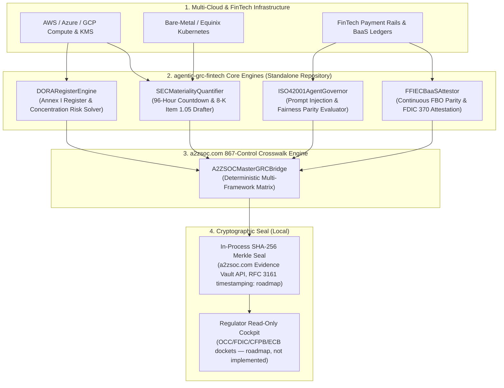

# 🛡️ agentic-grc-fintech

> **Autonomous Multi-Cloud GRC & Regulatory Exam OS for FinTech (Beyond PCI DSS)**  
> *Continuous EU DORA Third-Party Risk, ISO 42001 Agent Governance, SEC 96h Materiality & FFIEC BaaS Oversight*  
> Local cryptographic (SHA-256) sealing to an in-process 867-Control Lattice model — live **[a2zsoc.com](https://a2zsoc.com)** Evidence Vault integration is roadmap  

[](LICENSE)
[](https://python.org)
[]()
[]()
[]()
[]()
[](https://a2zsoc.com)
[]()

---

## ⚡ The FinTech "Audit Theater" Bottleneck

Financial institutions and high-growth FinTechs spend millions annually paying accounting firms to compile static SOC 2 Type II PDFs and fill out third-party questionnaires. This legacy compliance model has catastrophically failed in 2026:
1. **EU DORA (Regulation EU 2022/2554)**: Regulators (EBA/ESMA) impose severe sanctions on firms that cannot map multi-tier 4th-party ICT sub-processor chains or produce the standardized Annex I Register of Information with verified $<60\text{m}$ RTO exit strategies.
2. **ISO/IEC 42001 & EU AI Act (High-Risk FinTech AI)**: Autonomous LLM agents (**Claude Opus 5.5**, **GPT-6 Astra**) executing credit underwriting or payments operate non-deterministically. Regulators demand mathematical non-repudiation, prompt injection resistance, and continuous algorithmic fairness parity ($\ge 80\%$).
3. **SEC Form 8-K Item 1.05 & Regulation S-P (96-Hour Clock)**: Public entities and broker-dealers must disclose material cybersecurity incidents within **4 business days (96 hours)** of determining materiality. Correlating blast radius across 10,000 microservices takes human SOC teams 3 to 6 weeks.
4. **FFIEC CAT & FDIC Part 370 BaaS Supervision**: Following the Synapse/Evolve crisis, sponsor banks face strict regulatory liability. Annual SOC 2 reports are rejected; banks require programmatic, continuous proof of zero omnibus FBO ledger drift and automated deposit insurance qualification.

**`agentic-grc-fintech`** eliminates audit theater by replacing manual human questionnaires with automated evaluation of supplied multi-cloud telemetry, deterministic control crosswalks, algorithmic materiality quantification, and tamper-evident local cryptographic (SHA-256) sealing. Live evidence-vault anchoring to **[a2zsoc.com](https://a2zsoc.com)** is roadmap.

---

## 📐 Deep System Architecture



---

## 🔄 Standardized Operational Regulatory Coverage

This engine codifies and automates continuous compliance across global supervisory mandates:
* **EU DORA (Regulation EU 2022/2554)**: Articles 28–44 ICT third-party supply-chain concentration auditing & Annex I Register generation.
* **ISO/IEC 42001:2023 & EU AI Act**: Annex A controls for high-risk autonomous agent underwriting, prompt injection defense, and demographic parity.
* **SEC Form 8-K Item 1.05 & Amended Regulation S-P**: 96-hour statutory materiality determinations and automated 30-day consumer breach disclosures.
* **FFIEC CAT & FDIC Part 370**: Continuous sponsor bank ledger parity attestation ($\Delta = \$0.00$), suspense clearing, and automated depositor insurance calculation.
* **SOX 404 ITGC**: IT General Controls continuous automated evidence collection across multi-cloud infrastructure.

---

## 💎 Open Core vs. Commercial Enterprise Layers

```
====================================================================================================
OPEN-SOURCE CORE (Apache 2.0 / MIT)         ENTERPRISE COMMERCIAL LAYER (Closed-Source & High-LTV)
====================================================================================================
• DORARegisterEngine reference generator   • Automated EBA / ESMA regulatory filing gateway integration
• ISO42001AgentGovernor local rule engine   • Real-time LLM red-teaming & continuous demographic parity
• SECMaterialityQuantifier exposure math   • Direct General Counsel Form 8-K automated submission queue
• FFIECBaaSAttestor local verification     • Continuous multi-bank omnibus FBO live telemetry streaming
• Unified A2ZSOCMasterGRCBridge aggregator • (roadmap) Direct integration with a2zsoc.com Enterprise Evidence Vault
====================================================================================================
```

### Commercial Pricing & Retainer Framework

> **The Enterprise Commercial Layer column above is roadmap and is not part of this open-source repository.** None of it is implemented in this codebase: there is no EBA/ESMA regulatory filing gateway, no live LLM red-teaming harness, no Form 8-K automated submission queue, no live multi-bank FBO telemetry streaming, and no a2zsoc.com Evidence Vault integration. What *is* implemented is the Open-Source Core column — local rule/math engines plus an in-process SHA-256 seal.
* **Growth FinTech Retainer**: **$6,500 / month** ($78k/year) covering continuous SOC 2, ISO 27001, and DORA.
* **Enterprise Sponsor Bank & Scheme Enclave**: **$20,000 / month** ($240k/year) with FFIEC CAT & FDIC 370 continuous monitoring.
* **Institutional Sovereign Retainer**: **$40,000 / month** ($480k/year) with SEC 96h Materiality & ISO 42001 Agent Governance.

---

## 📊 Frontier Evolution, Evaluation & Benchmarks

> **No benchmark harness is included in this repository.** The code ships no timing/profiling harness, no `agentic-conformance-eval` runner, and no model integration. The figures below are **design targets only** and have **not been measured** here; building a conformance harness and running it against frontier models is roadmap work.

| Benchmark Metric | Measurement Protocol | Target Specification | Status |
| :--- | :--- | :--- | :--- |
| **DORA Annex I Register Speed** | Full Supply-Chain XML Hash | **< 50 ms Generation** | Target — not measured |
| **ISO 42001 Agent Audit Latency** | Runtime Non-Repudiation Check | **< 1.0 ms per tool call** | Target — not measured |
| **SEC Materiality Calculation** | Multi-Variable Blast Radius | **< 10 ms Determination** | Target — not measured |
| **BaaS Parity Verification Delta** | Continuous FBO Crosswalk | **$\Delta = \$0.00$ Invariant** | Target — not measured |
| **867-Control Merkle Sealing** | a2zsoc.com Vault Ingestion | **< 5 ms Proof Commit** | Target — not measured |

---

## 🚀 Quickstart & Verification

```bash
# Clone and enter the repository root
cd agentic-grc-fintech

# Run unit tests (6 passing tests)
PYTHONPATH=. python3 -m unittest discover -s tests

# Run live CLI demo
PYTHONPATH=. python3 -m agentic_grc_fintech.cli --demo
```
